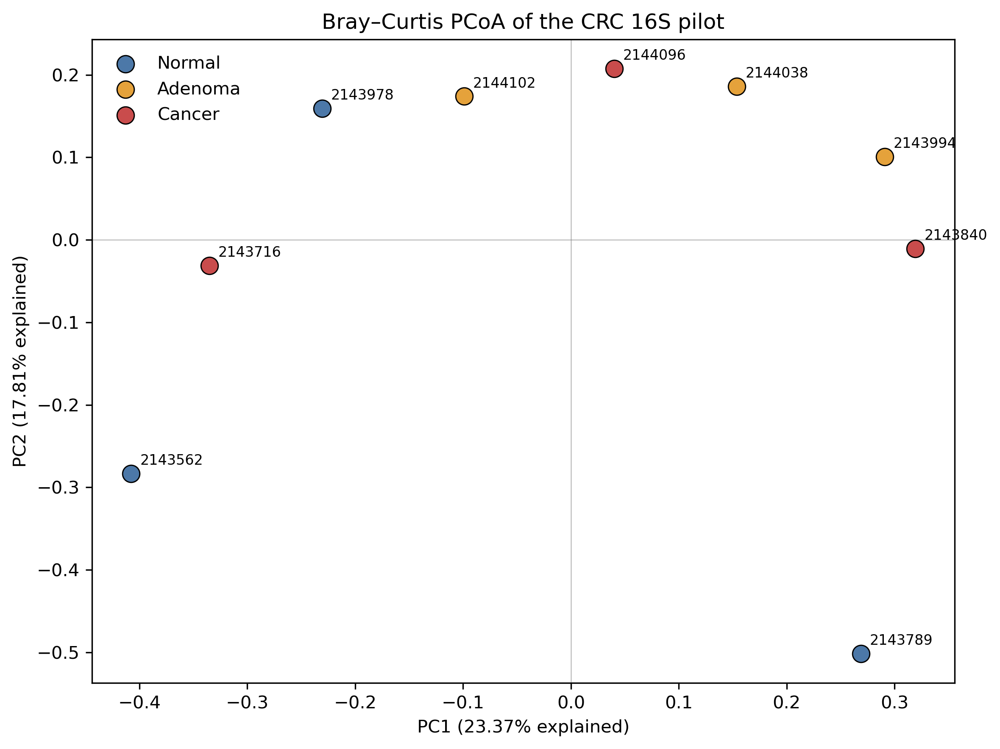
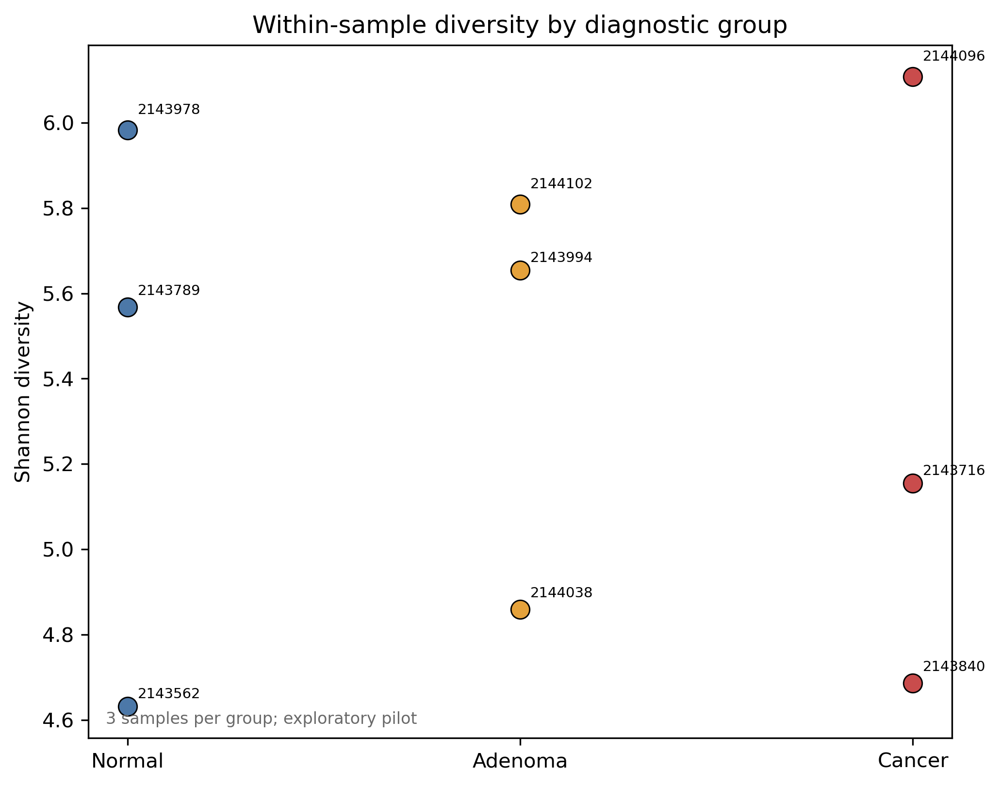
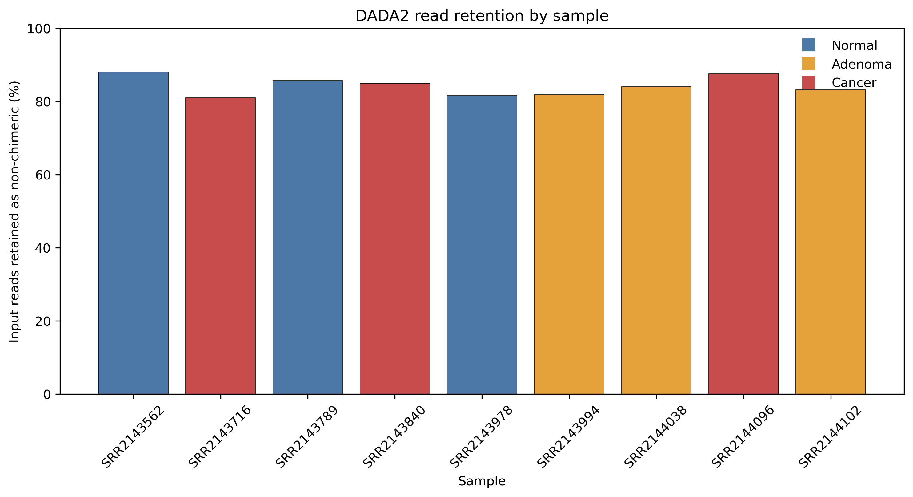

# Gut Microbiome Across the Colorectal Adenoma–Carcinoma Sequence

## Project overview

This repository documents a nine-sample 16S rRNA amplicon sequencing pilot using publicly available data from the Baxter et al. study (NCBI BioProject: PRJNA290926).

The pilot was developed to learn and evaluate a reproducible microbiome analysis workflow across three diagnostic groups:

- Normal controls
- Adenoma
- Colorectal cancer (CRC)

The current analysis focuses on microbial community composition and diversity. Because this is 16S amplicon data, it does not directly measure microbial genes, bile-acid metabolism, or other functional pathways.

## Dataset

- Study: Baxter et al.
- NCBI BioProject: [PRJNA290926](https://www.ncbi.nlm.nih.gov/bioproject/PRJNA290926)
- Pilot size: 9 samples
- Groups: 3 normal, 3 adenoma, 3 CRC
- Sequencing: paired-end 16S rRNA amplicon reads
- Sample metadata: `qiime-metadata.tsv`

The sample-level diagnostic grouping used in this pilot is the `dx` column. The original `stage` field was not used for group comparisons because its values were inconsistent for this subset.

## Workflow

The pilot analysis used QIIME 2 (release 2026.7) and included:

1. Import of paired-end sequencing reads.
2. Read denoising, merging, and chimera removal with DADA2.
3. Taxonomic classification using a SILVA 144 classifier trained for the V4 region.
4. Taxonomic composition visualisation.
5. Alpha-diversity summaries using Shannon, Simpson, and Pielou evenness.
6. Bray–Curtis dissimilarity and principal coordinates analysis (PCoA).
7. PERMANOVA to explore community composition differences among diagnostic groups.

The DADA2 truncation settings used were 240 bases for forward reads and 200 bases for reverse reads.

## Pilot results

### Read processing

All nine samples produced non-chimeric sequences after DADA2 processing. The number of non-chimeric sequences varied between samples, from approximately 15,800 to 101,300.

### Alpha diversity

Shannon diversity, Simpson diversity, and Pielou evenness were calculated for each sample. The small pilot showed variation within diagnostic groups and did not establish a clear, consistent diversity trend across the normal–adenoma–cancer sequence.

These exploratory values were calculated from the unrarefied feature table. Differences in sequencing depth should be considered when interpreting them.

### Beta diversity

The first two PCoA axes explained approximately 23.37% and 17.81% of the variation in the Bray–Curtis ordination, respectively.

The groups overlapped visually in the ordination. The overall PERMANOVA result was not statistically significant (pseudo-F = 0.981, p = 0.537; 999 permutations).

This result does not demonstrate that the groups have identical microbiomes. With only three samples per group, the analysis has limited power to detect group differences.

## Figures

### Bray–Curtis PCoA

The first two axes explain 23.37% and 17.81% of the variation, respectively. The diagnostic groups overlap visually in this small pilot.

### Shannon alpha diversity

Values vary between samples, with only three samples in each diagnostic group. These exploratory values were calculated from an unrarefied feature table.

### DADA2 read retention

All nine samples retained non-chimeric reads after processing. Retention percentages are shown per sample.

## Limitations

- This is a small pilot with three samples per group, not a powered disease-association study.
- 16S amplicon sequencing does not directly quantify microbial functional genes or metabolic pathways.
- Alpha-diversity estimates were exploratory and were calculated from an unrarefied feature table.
- The analysis should not be used to infer causation or make clinical claims.
- Primer handling and the complete end-to-end workflow still require further validation before the analysis can be considered fully reproducible.

## Repository contents

- `qiime-metadata.tsv`: metadata for the nine pilot samples.
- `manifest-template.tsv`: template for specifying paired-end FASTQ locations.
- `results/`: summary diversity values, DADA2 statistics, ordination coordinates, and pairwise PERMANOVA output.
- `scripts/qiime2_workflow.sh`: preliminary workflow input-check script, not yet a complete executable pipeline.

Large sequencing files and QIIME 2 artifacts are not included. Raw data should be obtained from the original public study, and the reference classifier should be downloaded separately from the SILVA/QIIME 2 resources.

## Next steps

- Validate primer removal and read-processing choices.
- Generate publication-quality figures from the exported results.
- Expand the pilot to a larger, appropriately powered sample set.
- Use suitable shotgun metagenomic datasets for any future investigation of bile-acid or lipid-metabolism genes.

## Acknowledgements

Data originate from the publicly available study associated with NCBI BioProject PRJNA290926. Please consult the original study for its publication details and data-use information.
